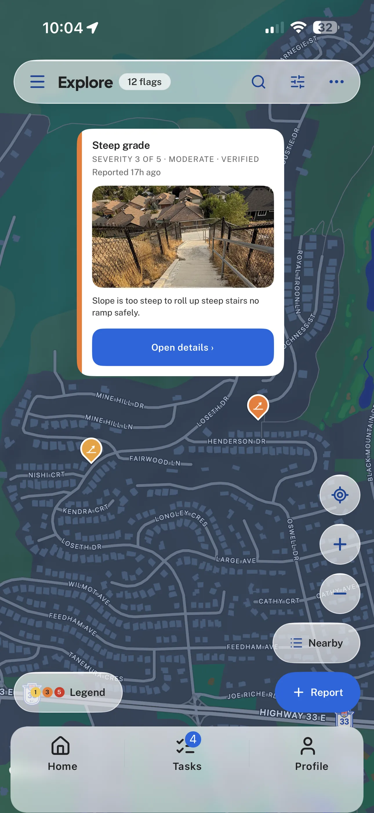

# Flagstone

**A community map for reporting and verifying accessibility barriers.** Someone who finds a missing
curb ramp, a broken sidewalk, a blocked path, a missing crossing signal or a steep grade drops a flag
on the map, and other people confirm it, mark it resolved, or reject it. The result is a shared,
current picture of the barriers that stop people who navigate the physical world differently, so
they can plan around them and so the barriers get fixed.

- **Try it:** [flagstone.skypistudio.com](https://flagstone.skypistudio.com). Browse the live map as
  a guest; no account needed.
- **Get the iPhone app:** [Flagstone Accessibility Map](https://apps.apple.com/app/flagstone-accessibility-map/id6774709116)
  on the App Store, free, in the United States and Canada.
- **Check the claims:** [docs/PUBLIC_EVIDENCE.md](docs/PUBLIC_EVIDENCE.md) routes to the testing,
  accessibility, privacy and release records behind this page.

<p align="center">
  
</p>

> **Flagstone or AccessMap?** Flagstone is the product: every flag report is a stone, and laid down
> one by one they pave a path everyone walks. AccessMap was the working name until the 2026-08-17
> rename, and it deliberately remains the repository name and the technical identifier: bundle ID
> `com.accessmap.app`, EAS project slug `accessmap`, URL scheme `accessmap://`. Changing those would
> orphan the build project and break existing deep links. Records written before the rename say
> AccessMap because that was the name at the time.

## Where it stands (as of 2026-10-29)

| | |
|---|---|
| **iOS app** | **Flagstone 4.1.1** has been on the App Store since 2026-09-15, free, in the United States and Canada only (storefront lookup rechecked 2026-10-29). The [release manifest](release/current.json) records the 4.1.1 submission as iOS build 33, from source `f559417`; its App Store field still reads `submitted_for_review` because it changes only through the release tool. The launch is recent, so no download or usage figures are claimed. |
| **Web version** | [flagstone.skypistudio.com](https://flagstone.skypistudio.com) serves the 2026-10-25 web release, deployed from source `4a27691` on a frozen release branch ([receipt](qa-reports/releases/2026-10-25_Flagstone_4.1.1_Build33_OptionB_WebDeployment.md)). It is a web-only descendant of the 4.1.1 build: it adds the later `main` work and a lighter, accessible first launch, and it does not change the iOS app. It is pinned by design and does not follow `main`. |
| **`main`** | Work since the 4.1.1 build: database contract and migration truth, moderation semantics, an anonymous-read privacy contract, and account-deletion accuracy. Its database changes were applied to the shared production backend from 2026-09-15 and serve both apps; its client-side parts shipped to the web on 2026-10-25, and the iOS app still runs the 4.1.1 client. Two paths, client-side flag deletion and admin flag removal, stay switched off until safer backend contracts exist. |
| **Quality gates** | Every pull request to `main`, and every push to it, runs strict TypeScript, ESLint, the Jest suite with its coverage gate, a migration-crosswalk check, a replay of every database migration against PostgreSQL 17, and a performance-budget check; a release-identity check runs when release records change. CI passed on the October web release merge (`4a27691`) and on the release-record commit after it. Dated full-suite results, including environment-specific failures, are in the [evidence map](docs/PUBLIC_EVIDENCE.md). |
| **Known limits** | The Lighthouse check on pull requests enforces a 135 KiB unused-JavaScript budget, measured in CI on 2026-10-29 after Supabase was moved off the welcome screen; the default 20 KiB limit is out of reach for the current web runtime, and the budget may only go down. Physical Safari, VoiceOver, iPhone and iPad testing of the October web release is still to do; automated Chromium and WebKit checks are not a substitute. |

## What Flagstone 4.1.1 does

- **Report a barrier** with a category, a 1–5 severity shown as number, word and colour together,
  and an optional description. Signed-in users can add a photo; its location metadata is stripped
  before upload, and the upload is refused if the stripping can't be verified.
- **Use it without an account.** Guests can browse the whole map and report anonymously. An account
  is needed to verify or resolve someone else's report, to comment, and to earn points.
- **Verify as a community.** Reports move from open to verified to resolved (or rejected), with a
  visible status history, and contributors earn points, tiers and badges.
- **Map and list views.** A native map on iOS and a Leaflet/MapLibre map on the web, marker
  clustering, a density heat map that only shows zones with at least three reports, and an
  accessible list view that opens automatically when a screen reader is on.
- **Accessibility first.** Designed against WCAG 2.2 AA: screen-reader labels, Dynamic Type, Reduce
  Motion, 44-point touch targets, and colour that is never the only signal, with guard tests that
  keep it that way ([accessibility statement](docs/accessibility.html)).
- **Moderation and privacy.** Flags and comments can be reported, people blocked and comments hidden
  locally, under published community guidelines. There is no advertising, analytics or tracking;
  data lives in Supabase behind row-level security, and the only other service that receives
  user-entered data is OpenStreetMap's Nominatim, for address search.

## How it was built

Flagstone is Skyler Halisky's project. Sky set the product direction and its accessibility and privacy
commitments, ran simulator and on-device QA, and made the product, moderation, privacy and release
decisions recorded in [DECISIONS_LOG.md](DECISIONS_LOG.md) and the QA handoffs. Sky also holds final
authority over merges to `main`, production deployments and App Store submissions.

The code, audits and reviews were produced with AI coding agents (mainly Claude Code and OpenAI Codex,
plus some October web work by Xiaomi's MiMo),
working under written repository rules ([AGENTS.md](AGENTS.md)), guard tests that turn product
promises into CI checks, and a release process that proves identity by exact commit rather than by
branch name ([docs/RELEASE_IDENTITY.md](docs/RELEASE_IDENTITY.md)). Most changes come with a dated
report in [`qa-reports/`](qa-reports/) or [`design-reviews/`](design-reviews/), and production
deployments and App Store submissions require Sky's sign-off. The approvals for the October web
release are public: the [source-merge approval](https://github.com/Skypie99/AccessMap/pull/35#issuecomment-6392586946)
and, separately, the [production approval](https://github.com/Skypie99/AccessMap/pull/35#issuecomment-6394476701).

## Stack

Expo SDK 54 · React Native 0.81 · React 19.1 · TypeScript (strict) · Supabase (Postgres with
row-level security, Auth, Storage, Realtime, Edge Functions) · react-native-maps on iOS, react-leaflet
with MapLibre and OpenFreeMap tiles on the web · Jest and Testing Library · pgTAP · EAS for iOS
builds · Vercel for the web version.

## Repository map

| Path | What's there |
|---|---|
| `App.tsx`, `src/` | The app: `screens/`, `components/` (with `ui/` primitives), `lib/` (data, auth and privacy helpers), `navigation/`, `theme/`, `moderation/`, and the `__tests__/` guard tests |
| `supabase/` | `migrations/` (the canonical, forward-only schema history), `contract/` (client–database contract), `tests/` (pgTAP), `functions/` (Edge Functions) |
| `release/` | [`current.json`](release/current.json), the machine-readable record of what shipped |
| `scripts/` | Release-identity and database tooling (migration replay, catalog checks) |
| `docs/` | Architecture, database, release policy, privacy and accessibility pages, and the [evidence index](docs/PUBLIC_EVIDENCE.md) |
| `qa-reports/`, `design-reviews/`, `security-audit/` | Dated QA, design and security records: evidence for their date, not current authority |

## Run it locally

CI uses Node.js 22; use the same version locally.

```bash
npm install            # .npmrc sets legacy-peer-deps (react-leaflet 5 alongside React 19.1)
cp .env.example .env   # add your Supabase project URL and anon key
npm start              # Expo dev server
npm run web            # the web build in a browser
```

The app needs a Supabase project with this schema. The schema's source of truth is the ordered
migration history in [`supabase/migrations/`](supabase/migrations/); CI replays it into a disposable
PostgreSQL 17 (`npm run db:replay`, which needs PostgreSQL 17 installed locally).
`supabase/schema.sql` is an older, partial snapshot, not a complete bootstrap.

Before sending a change:

```bash
npm run typecheck && npm run lint && npm test
```

## Working on the code

- Map code goes through `src/components/PlatformMap.tsx` and `PlatformMap.web.tsx`. Importing
  `react-native-maps` anywhere else breaks the web bundle.
- Before any release or deployment work, read [`release/current.json`](release/current.json) and
  [docs/RELEASE_IDENTITY.md](docs/RELEASE_IDENTITY.md), and run `npm run release:verify`.
- Rules for AI coding agents working in this repository are in [AGENTS.md](AGENTS.md).

## Reporting a problem

Found something broken in the app or on the web? [Open an issue](https://github.com/Skypie99/AccessMap/issues/new/choose)
with the steps to reproduce, or email support@skypistudio.com. Issues are public, so leave out
personal details, exact home locations and photos of people. Barrier reports belong on the map
itself, not in issues. The [support page](https://skypistudio.com/flagstone/support/) covers account
deletion and common questions.

## License

[MIT](LICENSE)
